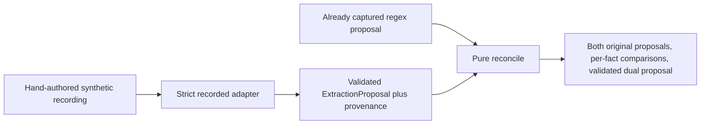

# Phase 2 independent review handoff

Phase 2 adds the required cited-capture safeguard, a strict recorded-response
adapter, and pure deterministic reconciliation. All implementation changes are
confined to the experimental package and tests. No production engine module,
entry point, fact vocabulary, recognition algorithm, policy, verification,
fingerprint algorithm, governance behavior, or dependency changed.

## Branch identity

- Approved starting Phase 1 commit: `34cd003896d912b924fd44c154770896e122a8c2`.
- Branch: `codex/dual-extraction-phase2`.
- Isolated checkout: `/private/tmp/pa-copilot-dual-extraction-phase2`.
- Citation gate: `e2242e8b3a79d7adfe33bb2fe5606067ee9adc39`.
- Recorded adapter: `ea202d8be04d630278d6544d4dd2bc22465ed751`.
- Reconciliation and examples: `29d182c7e721b257e5a0ad67be320a701bcb8c20`.
- Final delivery commit and post-push clean status are supplied in the delivery
  handoff. This report is committed after implementation and cannot embed its own
  commit hash; resolve the pushed tip with
  `git rev-parse origin/codex/dual-extraction-phase2`.

The fetched Phase 1 remote reference matched the approved commit before branch
creation. The main checkout, its unrelated untracked files, and the Phase 1
worktree were left untouched. No merge, tag, deployment, model call, or Phase 3
runner was performed.

## Architecture and decisions

`ExtractionProposal` now requires retained exact citations for every captured
fact. This is an experimental entry gate, not a production service rule change.
Missing/review evidence semantics are retained. The exact `osa_diagnosis=True`
with empty evidence reproduction and each of the 12 fact keys are tested.

`adapt_recorded_response(note, payload)` validates JSON shape, all 12 keys, exact
extractor value types, explicit states, note SHA-256, source quotations, offsets,
and cap/count structure before returning a proposal. It preserves source, model,
prompt version, response identity, and normalized recording hash in experimental
metadata. The three committed fixtures explicitly declare
`origin=hand_authored_synthetic` and `model_id=synthetic-no-model`; none is claimed
to have been produced by a real model. The schema intentionally accepts only this
origin in Phase 2.

`reconcile(regex_proposal, recorded_llm_proposal)` revalidates its inputs, requires
identical original notes, and applies the approved state/value table. It makes
no extraction, model, service, logging, or archive calls. Both originals survive
in the output. Scalar, state, retained citation set, citation order, and total
count comparisons are separate. Truncated citation comparisons are labeled
incomplete. Malformed/failed inputs raise fixed-code experiment failures, never
missing facts.

For canonical dual evidence, the regex role's retained citations are used when
present, otherwise the recorded role's citations, otherwise none. This is a fixed
presentation choice, not confidence ranking. There is no citation union or summed
truncation count. Every agreed captured field has regex evidence because of the
entry gate. Consequently the linked lumbar pair can only be jointly captured
when both sources captured both matching values, with both dual citation lists
retained from the regex proposal. This is source-level pairing, not automated
semantic course/episode verification.

Fixed numeric flags report a captured integer absent literally from its retained
quotations. They can expose suspicious values for investigation but introduce no
clinical cutoffs and change no facts/states. Legitimate unit normalization may
also be flagged. `clinical_verification` is always false, including deliberate
agreement on a semantically unsupported relative-attributed fact.

## Complete changed-file inventory

| File | Purpose |
| --- | --- |
| `experiments/dual_extraction/proposals.py` | Two-line retained-citation invariant |
| `test/test_extraction_citation_gate.py` | Test-first exact reproduction, all keys, unchanged missing/review semantics, counts |
| `experiments/dual_extraction/recorded.py` | Strict JSON recording contract and validated adapter |
| `experiments/dual_extraction/errors.py` | Payload-free explicit failure codes |
| `experiments/dual_extraction/reconcile.py` | Pure state/value reconciliation, evidence comparison, advisory observations |
| `experiments/dual_extraction/examples.py` | Explicit generation/check of two fixed review artifacts; no corpus/mode runner |
| `experiments/dual_extraction/fixtures/recorded/unicode-cpap.json` | Labeled synthetic Unicode example |
| `experiments/dual_extraction/fixtures/recorded/lumbar-agreement.json` | Labeled synthetic lumbar proposal |
| `experiments/dual_extraction/fixtures/recorded/duration-disagreement.json` | Deliberately unsupported six-week proposal cited from eight-week text |
| `test/dual_extraction_helpers.py` | Explicitly synthetic structural proposal builders for tests |
| `test/test_recorded_extraction.py` | Types/vocabulary, states, malformed responses, identities, citations, counts, privacy |
| `test/test_extraction_reconciliation.py` | Decision table, linked pair, evidence, errors, repeatability, metadata and verification limits |
| `test/test_extraction_examples.py` | Example contents, reproducibility and one capture per source |
| `experiments/dual_extraction/README.md` | Current package scope and Phase 2 link |
| `experiments/dual_extraction/__init__.py` | Updated package description; no imports added |
| `experiments/dual_extraction/PHASE2.md` | Protocol, reconciliation semantics, limitations and commands |
| `experiments/dual_extraction/PHASE2_REVIEW.md` | This independent-review report |
| `experiments/dual_extraction/artifacts/phase2-recorded-proposal-example.json` | Decoded example proposal and metadata |
| `experiments/dual_extraction/artifacts/phase2-reconciliation-example.json` | Both sources, dual proposal and per-fact comparisons |
| `experiments/dual_extraction/artifacts/phase2-entry-baseline-tests.txt` | Approved Phase 1 focused baseline |
| `experiments/dual_extraction/artifacts/phase2-gate-red.txt` | Failing citation-gate tests before the safeguard |
| `experiments/dual_extraction/artifacts/phase2-gate-green.txt` | Passing gate and inherited Phase 1 checks |
| `experiments/dual_extraction/artifacts/phase2-focused-tests.txt` | All focused Phase 1/2 test results |
| `experiments/dual_extraction/artifacts/phase2-regression-tests.txt` | Full final regression result |
| `experiments/dual_extraction/artifacts/phase2-quality.txt` | Lint, formatting, baseline and example check results |
| `experiments/dual_extraction/artifacts/phase2-artifact-checks.txt` | Fixed-clock generation, protected files and baseline byte comparison |
| `experiments/dual_extraction/artifacts/phase2-verification.json` | Machine-readable summary and evidence hashes |

## Verification evidence

| Check | Result |
| --- | --- |
| Approved Phase 1 focused baseline | 292 passed |
| Citation gate before implementation | 13 failed, 3 passed |
| Citation gate plus Phase 1 checks after safeguard | 308 passed |
| Final focused suite | 478 passed |
| Full regression suite | 2,159 passed; same 9 expected failures |
| Ruff / formatting | Passed; 94 Python files already formatted |
| Whitespace check | Passed |
| Frozen release baseline | All 177 cases, including 148 scoped evaluations, byte-for-byte identical |
| Fixed-clock artifact regeneration | All 27 tracked historical artifacts/goldens unchanged |
| Production file comparison to approved Phase 1 | No differences |
| Synthetic example regeneration | Byte-for-byte identical |

Focused tests comprise 292 inherited Phase 1 checks plus 186 new checks: 16 gate,
63 recording, 105 reconciliation, and 2 example tests. Local verification used
Python 3.12.3 and Ruff 0.12.0; it does not claim a separate local Python 3.13 run.
Historical generation uses `ACCEPTANCE_GOVERNANCE_NOW` at
`2026-09-01T00:00:00Z`. No policy snapshot timestamps, source hashes, freshness
windows, or trust evidence were refreshed.

The gate, recorded-adapter and reconciliation tests were written before their
implementations. Additional adversarial tests caught and closed two boundary
gaps: accepting raw Pydantic objects instead of JSON recording data, and serializer
warnings revealing values from malformed model copies. Errors now remain fixed
codes and malformed copies are rejected without those warnings. The full suite
was rerun after that final privacy fix.

Coverage includes all 177 regex proposal round trips and original fingerprints,
all 12 recorded fact vocabularies, invalid/uncited captures, exact Unicode versus
byte offsets, malformed/duplicate/nonfinite JSON, source/note binding, ordered
and truncated evidence, all state dispositions, 81 linked-therapy state
combinations, linked value conflicts, false captures, stable repeated results,
explicit extraction failures, metadata-independent production fingerprints, and
agreement without clinical verification. Existing archive/replay, governance,
attestation, historical golden and cross-surface tests remain unchanged and pass.

Frozen baseline SHA-256:
`af9a1805c42df33e2985542a7b85307262dfa0fe8ab33cfcbf7f69d2ece46728`.

## Example proposal and reconciliation

Inspect [the recording fixture](fixtures/recorded/duration-disagreement.json),
[the validated proposal projection](artifacts/phase2-recorded-proposal-example.json),
and [the full dual record](artifacts/phase2-reconciliation-example.json).
Each preserves all 12 keys, source metadata, states and exact citations.

| Fact | Regex | Synthetic recorded proposal | Dual result |
| --- | --- | --- | --- |
| `conservative_therapy_weeks` | CAPTURED 8 | CAPTURED 6, citing “PT for 8 weeks” | NEEDS_REVIEW / VALUE_DISAGREEMENT |
| `symptom_duration_weeks` | CAPTURED 8 | CAPTURED 8, with a different citation extent | CAPTURED / AGREED_CAPTURE, citation disagreement recorded |

The synthetic six-week value passes representation/citation-location validation
because six is an allowed integer and the quote exists. That does not make the
quote support six weeks. Its nonliteral numeric-support flag and disagreement
are inspectable, without claiming automated clinical adjudication. No model
performance, new clinical gold label, or promotion conclusion is implied.

## Limitations and unresolved questions

- Structural agreement does not establish semantic support, patient attribution,
  temporality, correct normalization, or clinical truth. Existing regex limitations
  and expected failures remain unresolved.
- Retaining one source's paired citations avoids cross-source assembly but cannot
  prove that either input already linked a real course correctly.
- Numeric lexical flags have false positives for valid normalization and false
  negatives when an implausible value appears literally. They are not clinical
  plausibility rules or confidence scores.
- Truncated source citations cannot be reconstructed. Recorded totals and model
  identities are declared provenance, not independently authenticated evidence.
- The recorded schema accepts hand-authored synthetic origin only. Genuine
  model-generated recordings require an explicit origin/provenance extension;
  no live provider behavior is implemented.
- There are no blocking design questions for this Phase 2 scope. Before broader
  numeric plausibility screening, an approved definition is needed. Before genuine
  recorded outputs, provenance/origin requirements must be selected. Neither is
  inferred or implemented here.

## Recommended Phase 3

Build only the offline three-mode comparison runner next. Freeze an agreed
synthetic corpus and recording manifest, capture regex and recorded proposals
once per case, and reuse those captures for regex-only, recorded-only, and dual
evaluations. Validate every LLM-derived/dual proposal before legacy conversion,
bind replay callables to the exact note, use the existing fixed governance clock,
and carry no attestations across modes. Preserve explicit failure records rather
than generating missing facts for failed sources.

Store source/provenance records, per-fact disagreements, and normalized downstream
evaluations in a separate experiment directory. Compare facts, states, citation
sets/order/counts and requirement outcomes, with denominators that distinguish
failed extraction from valid missingness. Keep production defaults, archives and
goldens unchanged. Continue using clearly labeled synthetic recordings; optional
live capture and any accuracy/promotion decision remain separately scoped work.

Phase 3 is not implemented in this branch.
