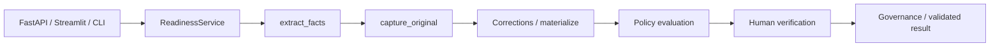
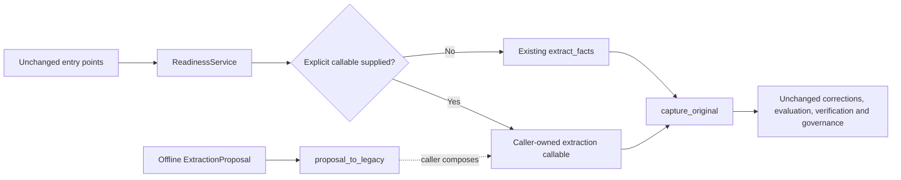

# Phase 1 independent review report

Phase 1 adds an explicit extraction dependency seam and offline proposal adapters.
Production defaults remain regex-only. No LLM parser/calls, credentials,
reconciliation, dual-mode generation, frontend, policy change, governance change,
release tag, merge, or deployment is included.

## A. Branch identity

- Repository: `NickLeko/PriorAuthorizationCopilot`.
- Starting release: `v2.7.0`, peeled commit
  `5d7a03f646eccd70e69bfc32f3281057b3bf6b54`.
- Fetched `origin/main` matched that release before implementation.
- Experimental branch: `codex/dual-extraction-phase1`.
- Isolated checkout: `/private/tmp/pa-copilot-dual-extraction-phase1`.
- Baseline commit: `b860832` (`test: freeze released regex behavior for extraction experiments`).
- Implementation commit: `ad1b06c0d27b91965eb0f841db75c269c41760dd`.
- Final delivery commit and post-push clean status are supplied in the handoff;
  resolve the branch tip with `git rev-parse origin/codex/dual-extraction-phase1`.
  This report is committed after the implementation, so it does not embed its
  own commit hash.

The original main checkout's unrelated untracked `soccer-practice-arena/` and
`docs/releases/v2.6.0-demo-check.png` were left untouched. Other worktrees were
not modified. Fetching and creating this branch were explicitly requested.

## B. Architecture

Before:



After:



The exact production type alias is:

```python
ExtractionCallable = Callable[[str], tuple[Dict[str, Any], Dict[str, List[Dict[str, Any]]]]]
```

`ReadinessService(..., extractor=None)` introduces one optional keyword-only
dependency. The callable receives the exact original note and returns the
existing fact/evidence tuple. An `EvidenceMap` remains a valid evidence dictionary
with its `total_counts` attribute. No injection means the existing module's
`extract_facts` is resolved at evaluation time; module monkeypatch behavior is
retained. An explicitly supplied falsey callable is honored.

`ExtractionProposal` contains the note, source, optional string diagnostics, and
an existing immutable `OriginalProposal`. It requires all 12 fact keys and reuses
the existing extractor vocabulary and correction validators. The legacy import
adapter validates raw types and exact citations before JSON capture. Export
revalidates the envelope and restores the review sentinel and original citation
counts into fresh legacy dictionaries. Source and diagnostics remain outside
clinical facts, production schema, and production fingerprints.

The service needed no new workflow: all downstream operations already consume
the fact/evidence tuple and captured snapshot. No abstract base class, registry,
async rewrite, framework, or extraction recognition refactor was necessary.

## C. Complete changed-file inventory

| File | Reason |
| --- | --- |
| `engine/service.py` | Callable type alias, optional constructor dependency, replacement of one extraction invocation |
| `experiments/__init__.py` | Isolated opt-in experiment namespace |
| `experiments/dual_extraction/__init__.py` | Phase 1 package marker; no automatic imports |
| `experiments/dual_extraction/README.md` | Contracts, limitations, regeneration and test instructions |
| `experiments/dual_extraction/baseline.py` | Explicit release capture/check, using existing synthetic inputs and historical governance clock |
| `experiments/dual_extraction/proposals.py` | Small validated proposal envelope and lossless adapters |
| `experiments/dual_extraction/artifacts/regex-v2.7.0.jsonl` | Separate observed-release baseline; no new clinical labels |
| `test/test_extraction_baseline.py` | Inventory, reproducibility, one-capture and explicit-regeneration checks |
| `test/test_extraction_proposals.py` | Round trips over all notes, strict representations, Unicode, citations, states and counts |
| `test/test_extraction_injection.py` | Default/explicit/adapted parity, attestations, archive/replay, governance and service validation |
| `experiments/dual_extraction/artifacts/verification.json` | Machine-readable verification summary |
| `experiments/dual_extraction/artifacts/release-tests.txt` | Full pre-change release test result |
| `experiments/dual_extraction/artifacts/focused-tests.txt` | Focused foundation test result |
| `experiments/dual_extraction/artifacts/regression-tests.txt` | Full post-change regression result |
| `experiments/dual_extraction/artifacts/quality.txt` | Ruff, formatting and baseline-check results |
| `experiments/dual_extraction/artifacts/artifact-checks.txt` | Fixed-clock artifact generation and protected-file comparison results |
| `experiments/dual_extraction/REVIEW.md` | This independent-review report |

Only one existing production module changed: `engine/service.py`, with 12 lines
added and 2 removed. Extraction recognition algorithms, fact contracts,
corrections, policy operators, schemas, archive/replay, entry points, dependencies,
clinical inputs, rules, provenance and policy snapshots are byte-for-byte unchanged
from the release. No production expectations were changed.

## D. Evidence

| Check | Result |
| --- | --- |
| Released full suite before implementation | 1,681 passed; 9 xfailed |
| Focused Phase 1 tests | 292 passed |
| Full post-change suite | 1,973 passed; same 9 xfailed |
| Ruff check | Passed |
| Ruff format check | 85 Python files already formatted |
| Whitespace check | `git diff --check` passed |
| Existing artifact/golden generation | All 27 tracked files unchanged from v2.7.0 |
| Baseline regeneration/check | Byte-for-byte match |
| Exact released engine comparison | Byte-for-byte match using an exported release tree |

Local runtime: Python 3.12.3 and Ruff 0.12.0. The existing CI configuration is
unchanged; this local run does not claim a separate Python 3.13 run.

The frozen corpus has 177 existing cases: 52 demo inputs, 91 contract examples,
20 independent regression notes, and 14 replay inputs. There are 148 full
service evaluations; the remaining 29 contract examples declare no procedure.
Known failure annotations and existing labels remain unchanged. Every case
contains all 12 observed facts, exact Python type names, states, citations and
offsets, pre-cap counts, source input identity/hash, and request metadata where
declared. The full scoped evaluations retain all fields except volatile audit
run IDs and timestamps. They do not carry synthetic human attestations.

The baseline was captured before changing production code. A second capture ran
the same capture utility against engine modules exported from the exact release:

```bash
git archive 5d7a03f646eccd70e69bfc32f3281057b3bf6b54 | tar -x -C /tmp/pa-phase1-release
PYTHONPATH=/tmp/pa-phase1-release python experiments/dual_extraction/baseline.py \
  --repo-root /tmp/pa-phase1-release --write --output /tmp/release-baseline.jsonl
cmp experiments/dual_extraction/artifacts/regex-v2.7.0.jsonl /tmp/release-baseline.jsonl
```

Create the empty destination directory before exporting. Executing the capture
file directly with `PYTHONPATH` pointing at that exported tree loads the released
engine, which has no injection seam. Both artifacts have SHA-256
`af9a1805c42df33e2985542a7b85307262dfa0fe8ab33cfcbf7f69d2ece46728`.

The 292 new tests consist of 5 baseline tests, 228 proposal/adapter cases, and 59
service-injection cases. All 177 notes survive legacy → proposal → legacy and
JSON transport. Comparisons retain exact scalar types, ordered citation arrays,
states, counts and original snapshot hashes. Dedicated tests cover Unicode
case expansion, deliberately non-sorted citation arrays, multiple fact citations,
15 original citations capped to 10, invalid fact vocabularies, missing/unknown
keys, mismatched quotations, invalid offsets, and invalid count metadata.

Service tests compare default regex, explicit regex, and adapted regex over all
52 demo inputs, including full normalized envelopes and verification fingerprints.
They also verify capped-count/fingerprint parity, original-note delivery, one call
per evaluation, per-service dependency isolation, unchanged module patches,
attestation validity, trusted/untrusted submission readiness, and rejection of
invalid injected citations. Archive reload and policy replay work without
re-extraction. Existing full-suite correction, verification, governance, historical
golden and FastAPI/Streamlit/CLI tests pass unchanged.

The test-first runs initially failed on absent baseline/proposal modules, before
implementation was added. No historical expected outcomes were changed.

Historical regeneration used the established `ACCEPTANCE_GOVERNANCE_NOW`,
`2026-09-01T00:00:00Z`. No monitoring timestamps, source hashes, freshness windows,
or trust evidence were refreshed. Production still uses its real clock.

## E. Limitations and later-adapter constraints

- This is structural compatibility evidence, not semantic accuracy or clinical
  validation. Existing negation, attribution, temporality, and course-linkage
  limitations remain, including the existing expected failures.
- Source-location integrity does not prove that a quotation supports a proposal.
- The original canonical snapshot sorts mapping keys. Mapping insertion order is
  not preserved; citation list ordering, exact values/types and every canonical
  downstream result are preserved.
- Already capped citation lists cannot reconstruct omitted quotations. Exact
  original counts survive; later reconciliation must not sum counts across
  sources and claim deduplicated totals it cannot establish.
- The proposal requires exactly the current 12 keys and existing extractor
  vocabulary. Reviewer-only values are rejected. Sleep-study presence is not a
  date, AHI documentation is a boolean, and addressed red flags can include denial.
- Backend identity is experimental metadata, not an input to existing production
  fingerprints. This foundation does not introduce mode-specific attestation
  semantics or permit automatic verification.
- The seam itself does not cache outputs. A later runner must capture each source
  once, bind it to the original note, and replay those captures across modes.
- Linked lumbar duration/response proposals must not be mixed across extractors.
  The current scalar boundary is not a general episode/course evidence model.
- No model/provider has been selected and no LLM quality claim is made.

## F. Smallest Phase 2

1. Add a recorded-response-only parser producing this same proposal envelope for
   all 12 keys. Test strict state/value vocabulary, exact note citations, source
   identity, and explicit errors for malformed/failed extraction. Use existing
   fixture notes; do not call a model or invent new clinical meanings.
2. Add pure reconciliation over two captured proposals. Preserve both inputs and
   diagnostic dispositions; captured-versus-missing and conflicting captured
   values require review. Preserve review states, distinguish failures from
   missing documentation, compare citations separately, and retain linked facts
   together. Agreement must never imply human verification.
3. Only then add the small offline runner that reuses source captures across
   regex-only, recorded-LLM-only and dual comparisons. Keep provenance outside
   production evaluations and report disagreements without promotion or accuracy
   claims. Optional live capture remains a separately bounded later step.

Phase 2 is a recommendation only and is not implemented in this branch.
